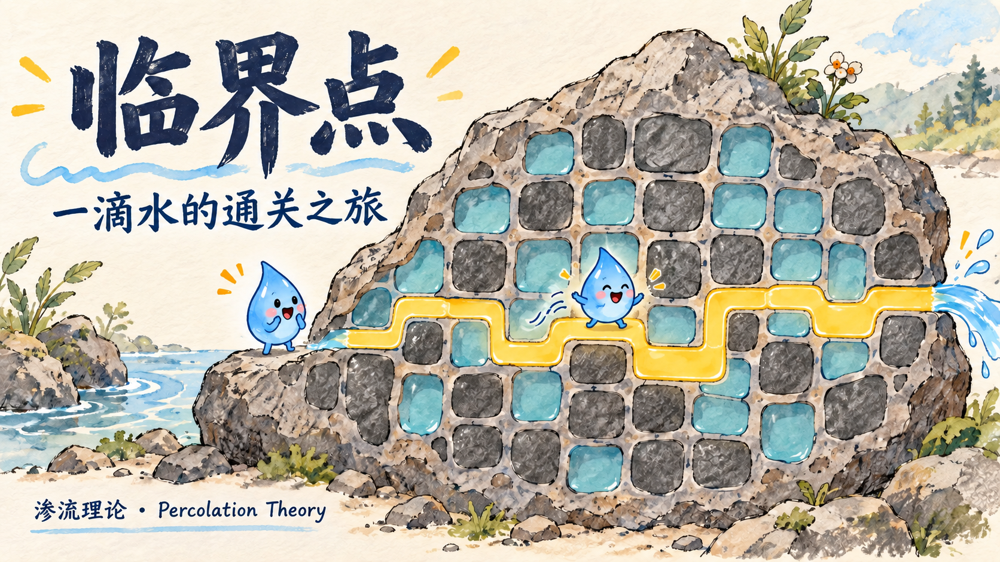
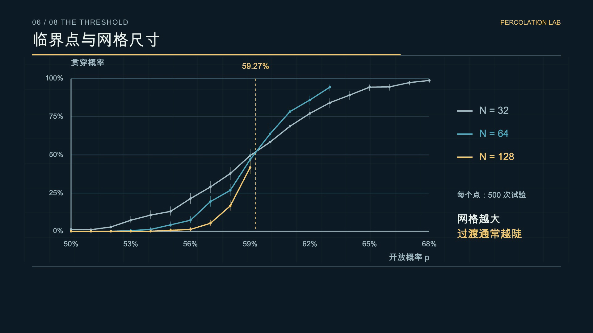

<div align="center">


# Percolation Theory · A Drop of Water Finds Its Way

**Chinese narration · English and Chinese subtitles · Hand-drawn-style illustrations · Reproducible simulations**

[Download video](https://github.com/2023Anita/percolation-theory-visual-guide/releases/download/v1.0.0/percolation-zh-en.mp4) · [Bilingual SRT](subtitles/bilingual.srt) · [中文说明](README.md)
</div>

## Why connectivity matters

Many pores do not guarantee a connected route. This 4-minute-25-second explainer turns a porous rock into a square grid and shows how opening probability, clusters and crossings relate.

The model is independent square-lattice site percolation with four orthogonal neighbors, open boundaries and left-to-right crossing detection. Water and conducting particles are connectivity illustrations, not simulations of physical flow or conductivity.

## Real simulation results

| p | Grid | Independent trials | Crossings | Rate | Wilson 95% CI |
| ---: | :---: | ---: | ---: | ---: | :---: |
| 0.58 | 128 × 128 | 1000 | 187 | 18.7% | 16.4%–21.2% |
| 0.60 | 128 × 128 | 1000 | 700 | 70.0% | 67.1%–72.8% |



The curves contain 57 points: three sizes, p = 0.50–0.68 in steps of 0.01, and 500 independent trials per point.

The approximately 59.27% theoretical threshold belongs to this particular infinite-lattice model. The selected 24 × 24 teaching example first crosses at approximately 58.43%; that sample value is not the theoretical threshold. A 60% passing grade is a grading convention, not a consequence of percolation.

## Reproduce

```bash
python3 -m venv .venv
source .venv/bin/activate
python3 -m pip install -r requirements.txt
python3 simulation.py
```

No API key is required. Seeds, random fields, paths and confidence intervals are provided in [data/](data/). To watch the local gallery, run `python3 -m http.server 8000` and visit `http://localhost:8000`.

The three [hand-drawn-style illustrations](assets/illustrations/) were generated with AI assistance and checked as schematic explanations. They are not measured samples. Chinese narration was synthesized through the official MiniMax speech API; English captions match the Chinese script sentence by sentence.

See [validation](docs/VALIDATION.md), [asset notes](docs/ASSETS.md), and [Newman & Ziff (2000)](https://arxiv.org/abs/cond-mat/0005264).
