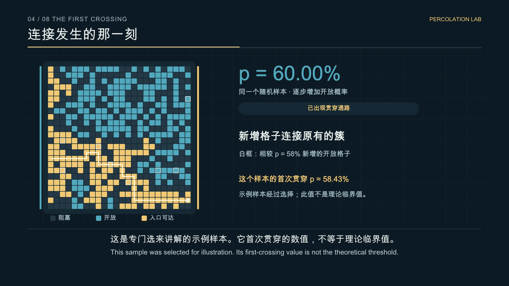
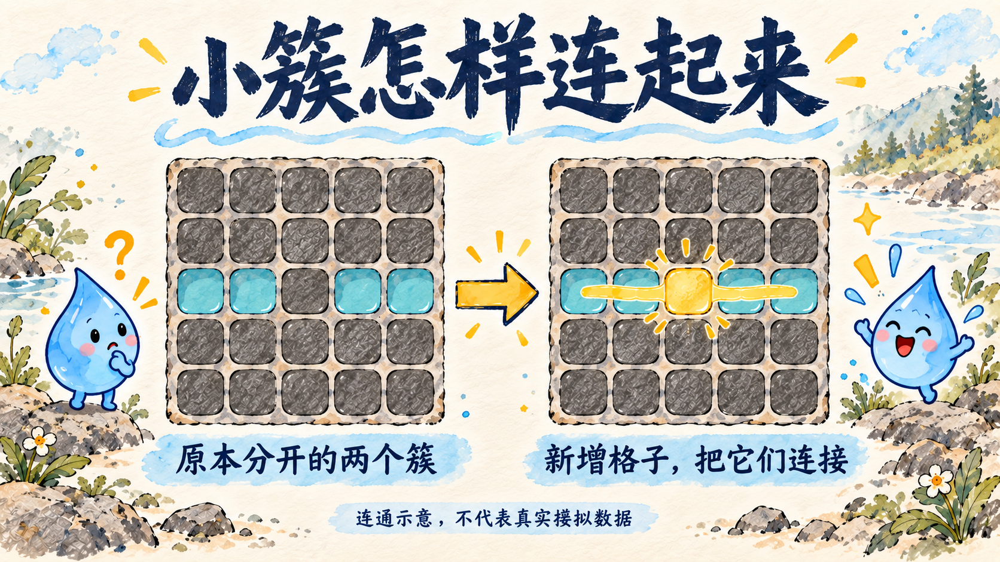
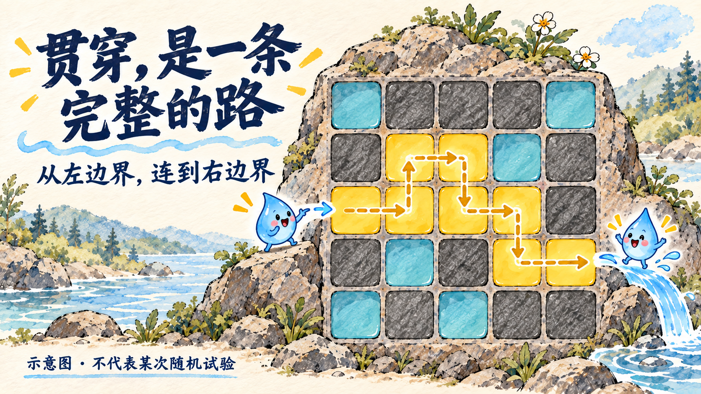
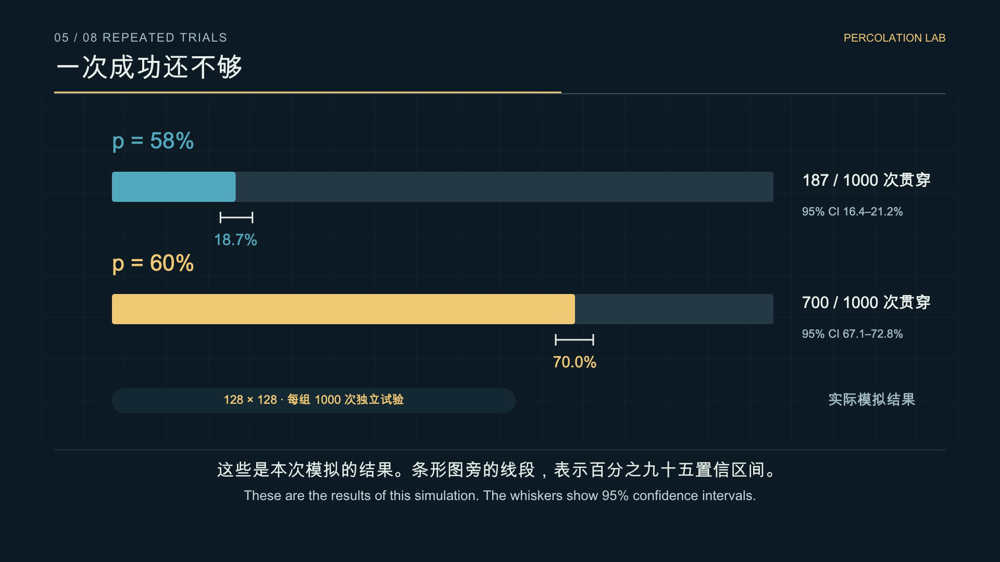

<div align="center">


# 临界点 · 一滴水的通关之旅

### Percolation Theory — From Local Connections to a Spanning Path

**中文科普视频 · 中英双语字幕 · 手绘视觉 · 可复现随机模拟**


[下载完整视频](https://github.com/2023Anita/percolation-theory-visual-guide/releases/download/v1.0.0/percolation-zh-en.mp4) · [视频文件](media/percolation-zh-en.mp4) · [双语字幕](subtitles/bilingual.srt) · [English](README.en.md)

</div>

---

## 数量之外，看连接

岩石有很多孔隙，水为什么仍然过不去？因为零散的孔隙，未必形成连接两端的通路。

这个项目从一滴水出发，把复杂岩石简化成规则方格，演示开放概率、连通簇和贯穿，再用重复随机试验理解临界附近的变化。

> 这里的水与导电颗粒都是**连通示意**。它们不计算真实流速、压力或材料电导率。

## 🎬 观看视频

[](media/percolation-zh-en.mp4)

**4 分 25.4 秒 · 1920 × 1080 · 30 fps · H.264 / AAC**

中文旁白使用 MiniMax 官方语音接口合成，英文字幕逐句对应中文解释。视频与字幕保存在仓库内，可通过上方入口或 [Release](https://github.com/2023Anita/percolation-theory-visual-guide/releases/tag/v1.0.0) 下载。

| 时间 | 章节 | 看懂什么 |
| :--- | :--- | :--- |
| 00:00 | 一滴水的难题 | 孔隙数量与连接关系 |
| 00:27 | 把岩石变成方格 | 点渗流、开放概率、四邻接 |
| 01:08 | 小岛怎样连成大陆 | 连通簇与入口可达区域 |
| 01:36 | 连接发生的那一刻 | 一个样本怎样首次贯穿 |
| 02:10 | 一次成功还不够 | 重复试验与置信区间 |
| 02:44 | 临界点与网格尺寸 | 有限尺寸效应 |
| 03:21 | 从孔隙到导电颗粒 | 简化的接触网络类比 |
| 03:49 | 数量之外，还要看连接 | 科学解释与比喻的边界 |

## 🎨 三张图，看清连接

### 01 · 四邻接规则


在本模型里，只允许上下左右相连。是否把对角算作邻居，会改变模型。

### 02 · 新增格子，合并小簇



数量增加可以通过连接关系的变化，改变整个网络的连通性。

### 03 · 贯穿，需要完整通路



三张插画为 AI 辅助生成的手绘风格教学示意，**不代表某次随机试验的观测结果**。真实试验请看下面的数据与视频画面。

## 🧪 真实模拟：58% 与 60%

模型条件：二维正方形格点、独立点占据、四邻接、开放边界、从左到右检测贯穿。

| 开放概率 p | 网格尺寸 | 独立试验数 | 贯穿次数 | 贯穿率 | Wilson 95% CI |
| ---: | :---: | ---: | ---: | ---: | :---: |
| 0.58 | 128 × 128 | 1000 | 187 | 18.7% | 16.4%–21.2% |
| 0.60 | 128 × 128 | 1000 | 700 | 70.0% | 67.1%–72.8% |



这些结果来自本项目的固定种子计算，不能被推广成所有网格或现实材料的固定成功率。

### 网格越大，临界附近的过渡通常越陡


曲线包含 **N = 32 / 64 / 128**，p 从 0.50 到 0.68、步长 0.01，每个点 500 次独立试验，共 57 个点。线段表示 Wilson 95% 置信区间。

## 科学边界

- **p 是开放概率**，不是单次样本必然达到的精确开放比例。
- **约 59.27%** 对应无限二维正方形格点、四邻接、独立点渗流的临界概率；它不是所有材料、网络或人生的通用常数。
- 视频的 N = 24 样本专门选来说明贯穿，首次贯穿约在 p = 58.43%；这个值不是理论临界值。
- 有限试验中零成功不能解释为数学上绝对不可能。
- **60 分及格是评价规则**。渗流只能作为理解学习连接的比喻，不能证明“学到 60% 就必然开窍”或“58% 的努力等于零”。

## 🔬 本地复现

只复现模拟，不需要任何 API 密钥。

```bash
git clone https://github.com/2023Anita/percolation-theory-visual-guide.git
cd percolation-theory-visual-guide
python3 -m venv .venv
source .venv/bin/activate
python3 -m pip install -r requirements.txt
python3 simulation.py
```

脚本保存各组固定种子，使用 NumPy 的四邻接 mask 膨胀检测连通；若环境已有 SciPy，会自动使用四邻接标记。CSV 和 JSON 提供完整统计、示例随机场与路径。

要在浏览器中打开本地展示页：

```bash
python3 -m http.server 8000
```

然后访问 `http://localhost:8000`。展示页直接播放仓库内的 MP4，并浏览插画和实际统计图。

## 文件导航

| 目录或文件 | 内容 |
| :--- | :--- |
| [index.html](index.html) | 本地视频与图集展示页 |
| [media/](media/) | 中文旁白、中英字幕完整 MP4 |
| [subtitles/](subtitles/) | 中文、英文、双语 SRT |
| [assets/](assets/) | 封面、三张手绘配图、成片关键帧 |
| [simulation.py](simulation.py) | 可复现点渗流模拟 |
| [data/](data/) | 统计 CSV、随机场、种子、路径 |
| [docs/narration.json](docs/narration.json) | 38 句中文稿与英文翻译 |
| [docs/schedule.json](docs/schedule.json) | 按实际音频建立的时间线 |
| [docs/ASSETS.md](docs/ASSETS.md) | 素材来源与生成说明 |
| [docs/VALIDATION.md](docs/VALIDATION.md) | 验收方法与范围 |

## 参考与制作

- Newman, M. E. J. & Ziff, R. M. (2000). [Efficient Monte Carlo algorithm and high-precision results for percolation](https://arxiv.org/abs/cond-mat/0005264). *Physical Review Letters*, 85, 4104.
- [MiniMax 官方语音文档](https://platform.minimax.io/docs/api-reference/speech-t2a-http)：中文旁白合成。
- 本项目借鉴一份中文 HTML 讲解的演示思路，重新组织解释与动画；统计数字来自仓库内代码。

**数量之外，看连接。一次结果之外，看概率。**
